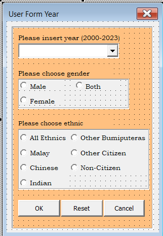
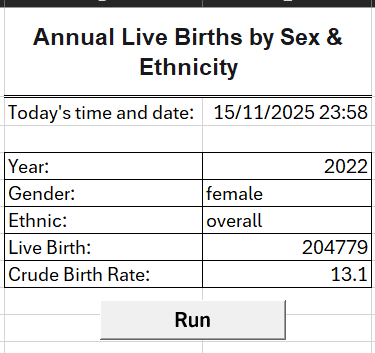

# Annual Live Births Lookup Tool (Excel VBA)

An Excel VBA application that lets a user look up **live births** and the **crude birth rate** for a chosen **year**, **sex** and **ethnic group** through a simple pop-up form, with no manual filtering or formulas needed.

Built with **Excel VBA**, **UserForms** and **VLOOKUP** as a portfolio project.

---

## Demo

<!-- Add your screenshots to the /screenshots folder and update the file names below -->

| Input form | Result on the Program sheet |
|:---:|:---:|
|  |  |

---

## Features

- **Run button** on the `Program` sheet opens a custom UserForm.
- **Year dropdown** covering 2000-2023.
- **Gender selection:** Both, Male, Female.
- **Ethnic group selection:** Overall, Bumiputera (Malay), Chinese, Indian, Bumiputera (Other), Other Citizen, Other Non-Citizen.
- **Input validation:** the user is prompted if the year is missing or an option is not selected.
- **Graceful handling of missing data:** shows `N/A` when no matching record exists or the value is blank/zero.
- **Reset and Cancel buttons** to restore the default selections or close the form.
- **Timestamp** of the last run is recorded in the workbook.

---

## How It Works

1. The user clicks **Run**, which calls the `ShowUserForm` macro and opens `UserFormYear`.
2. The user selects a year, gender and ethnic group, then clicks **OK**.
3. The code builds a lookup key in the format `year-sex-ethnicity`, e.g. `2022-female-overall`.
4. `VLOOKUP` searches the `birth_sex_ethnic` data sheet for that key (an exact match) and returns the live births and crude birth rate.
5. The inputs and results are written to `Program!E4:E8`.

```
User input  ->  Validate  ->  Build key ("2022-female-overall")  ->  VLOOKUP  ->  Display results
```

---

## Repository Structure

```
.
├── Birth_Statistics_Lookup.xlsm   # The workbook (data + form + macros)
├── src/
│   ├── Module1.bas                # Macro that opens the form
│   └── UserFormYear.cls           # Form logic (initialise, validate, lookup)
├── screenshots/                   # Images used in this README
└── README.md
```

> The files in `src/` are exported copies of the VBA code so it can be read directly on GitHub. The working version is inside the `.xlsm` file.

---

## Data

The `birth_sex_ethnic` sheet contains **504 records** covering **2000-2023**.

| Column | Description |
|---|---|
| `LookupKey` | Formula that combines year, sex and ethnicity, e.g. `2022-female-overall` |
| `date` | Reference date for the year (1 January of that year) |
| `sex` | `both`, `male`, `female` |
| `ethnicity` | `overall`, `bumi_malay`, `chinese`, `indian`, `bumi_other`, `other_citizen`, `other_noncitizen` |
| `abs` | Absolute number of live births |
| `rate` | Crude birth rate (live births per 1,000 population) |

**Source:** Malaysian live birth statistics by sex and ethnic group. *(Add the exact dataset name and link, e.g. from data.gov.my / DOSM, if you want to credit the original source.)*

---

## Getting Started

### Requirements
- Microsoft Excel (desktop version) with macros enabled

### Run it
1. Download `Birth_Statistics_Lookup.xlsm`.
2. Open it and click **Enable Content** when the security warning appears.
3. Go to the **Program** sheet and click **Run**.
4. Pick a year, gender and ethnic group, then click **OK**.
5. The result appears on the Program sheet.

### View the code
- Read the code directly in the [`src/`](src) folder, or
- In Excel, press `Alt + F11` to open the VBA editor.

---

## Skills Demonstrated

- VBA UserForm design and event handling (`Initialize`, `Click` events)
- Control logic with `If / ElseIf` for reading form inputs
- Input validation and user feedback with `MsgBox`
- Error handling (`On Error GoTo`, `On Error Resume Next`)
- Data lookup with `Application.WorksheetFunction.VLookup`
- Working with multiple worksheets and ranges from code

---

## Possible Improvements

- Read the available years from the data sheet instead of hard-coding 2000-2023.
- Replace `VLOOKUP` and `On Error Resume Next` with `Find` or `Match` for clearer error handling.
- Add a chart comparing the selected group's trend across years.
- Support English and Malay UI messages.

---

## Author

**Muhammad Alif Firdaus**
<!-- Add your GitHub / LinkedIn links here -->
